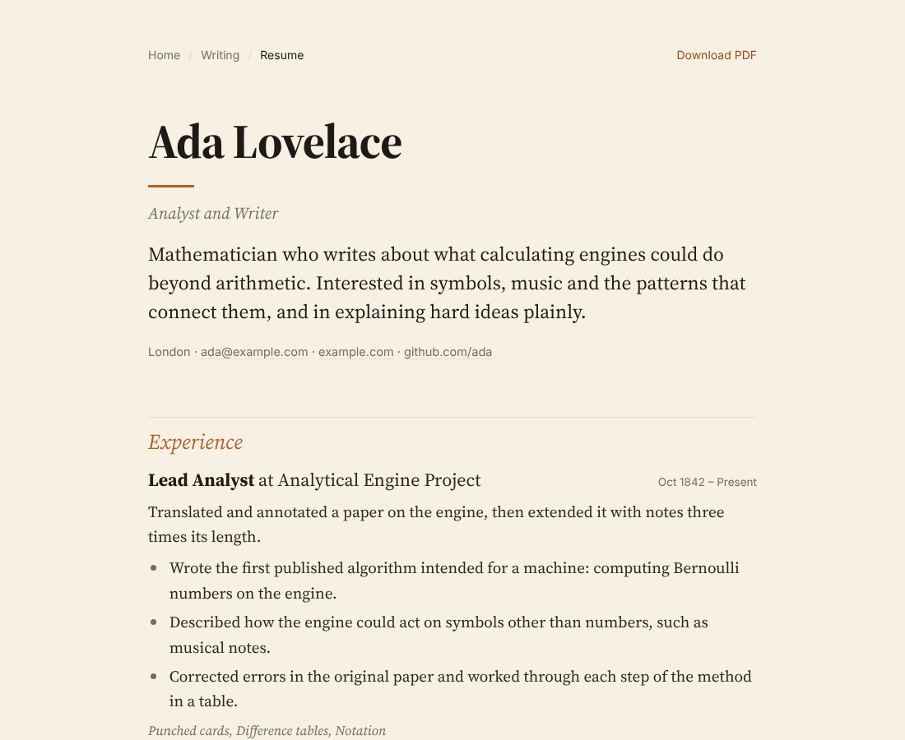
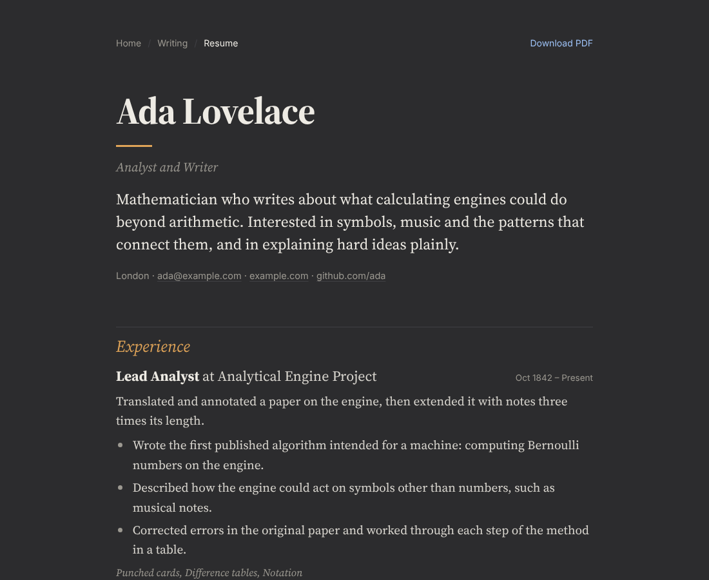
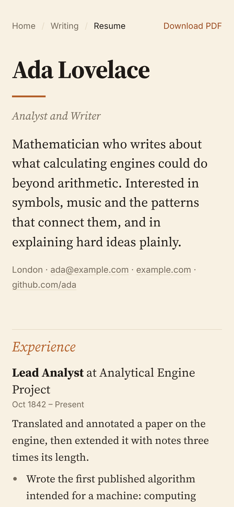
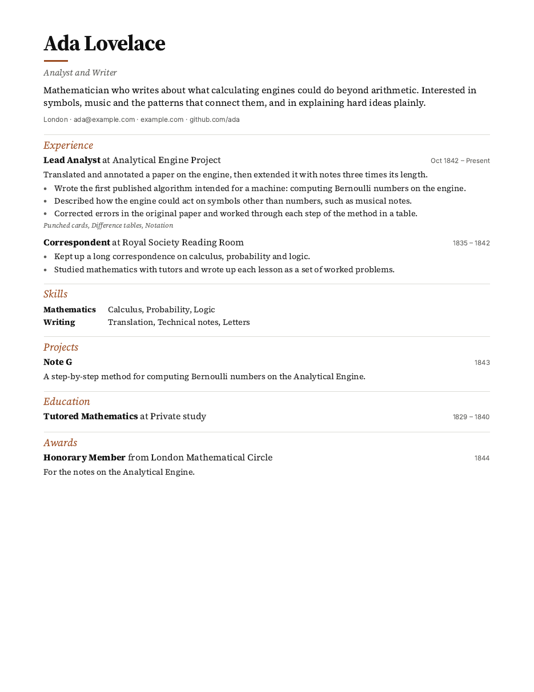

# jsonresume-theme-editorial

A [JSON Resume](https://jsonresume.org) theme. A large serif name over a short
accent rule, the summary set as an opening paragraph, italic section names in
the accent colour, and dates at the right edge of each entry. The palette is a
warm paper (a dark gray on a dark system), and the type is Source Serif 4 with
Inter for small details.

| Web, light | Web, dark |
| --- | --- |
|  |  |
| **Phone** | **PDF, first page** |
|  |  |

The screenshots show `example/resume.json`, a made-up resume.

`render(resume, options)` returns one HTML document with its styles and fonts
inside it. The same file is the web page and the source of the PDF: its print
styles set it in ink on white Letter paper, two pages for a typical resume,
and hide the navigation.

## Use

```bash
npm install jsonresume-theme-editorial
```

```js
const { render } = require("jsonresume-theme-editorial");
const html = render(resume, {
  nav: [{ label: "Home", href: "/" }, { label: "Resume", href: "/resume/", current: true }],
  pdf: "/resume/resume.pdf",
});
```

With [resume-cli](https://github.com/jsonresume/resume-cli):

```bash
resume export resume.html --theme editorial
resume export resume.pdf --theme editorial
```

| Option | Meaning |
| --- | --- |
| `palette` | `"sepia"` (the default) or `"white"`, for a site whose other pages are white. Both turn dark gray on a dark system and print in ink on white. |
| `dark` | `false` keeps the light palette on a dark system, for a site with no dark mode |
| `nav` | Links shown above the resume on screen: `[{ label, href, current }]` |
| `pdf` | Address of the PDF, for a Download PDF link beside them |
| `note` | A short tag beside that link, such as a variant name |
| `head` | HTML added to the end of `<head>`, for a site's own styles |

The page reads these CSS custom properties, so a site can restyle it through
`head`: `--column` (the text width, 740px), `--page`, `--text`, `--heading`,
`--muted`, `--rule`, `--link` and `--accent`.

Two things go beyond the JSON Resume schema. A `work` item may list its
technologies in `tech`. Prose fields may contain `<a href="https://...">`
links; any other tag is shown as text.

## Develop

The stylesheet and fonts are inlined into `assets.js` by `npm run build`, so
the theme reads no files when it renders. Commit `assets.js` after changing
`style.css` or `fonts/`; `npm test` fails while it is out of date.

```bash
npm run build
npm test
npm run preview -- example/resume.json   # writes preview/index.html
```

## Fonts

Source Serif 4 (Adobe) and Inter (The Inter Project
Authors), each under the SIL Open Font License; the licences are in `fonts/`.
The code is MIT.
